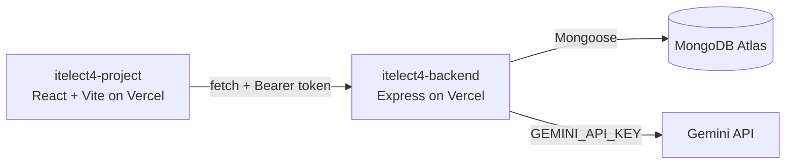
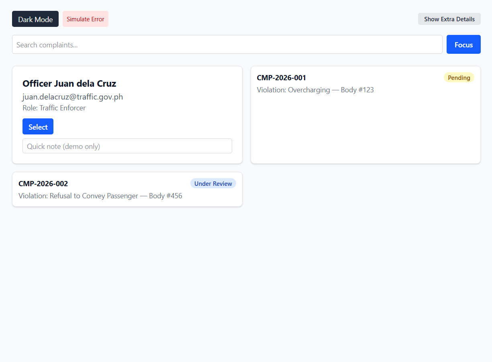
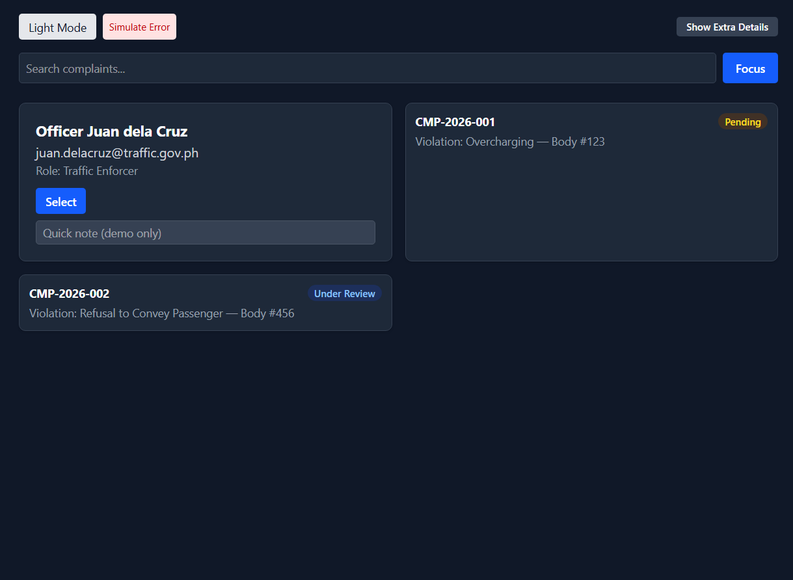
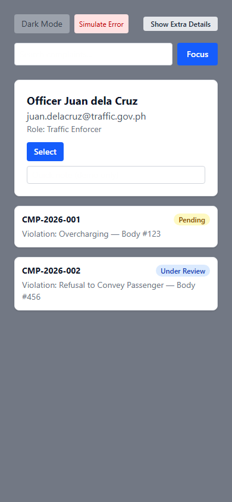

# Tricycle Complaint Impact System

[](https://github.com/LancePr0/itelect4-project/actions/workflows/ci.yml)

A tricycle complaint tracker built for the ITELECT4 course: register or log in, browse the registered tricycles, file a complaint against one, and ask an AI to review your complaint description before you file it. Built with React, TypeScript and Vite, styled with Tailwind CSS v4.

## Live

- Frontend (this repo): https://itelect4-project-fawn.vercel.app
- Backend: https://itelect4-backend-sigma.vercel.app
- Backend repo: https://github.com/LancePr0/itelect4-backend

## What it does

- Register / log in against the real API, with a token kept in the Zustand auth store
- Browse the registered tricycles (public, no login needed)
- File, list and view complaints, scoped to your own account
- AI Review page: describe an incident and get a structured review (summary, what's clear, what's missing, readiness) before filing
- Dark mode toggle, loading/error states throughout

## Architecture



## Running it locally

```bash
npm install
cp .env.example .env   # set VITE_API_URL, e.g. http://localhost:4000
npm run dev              # http://localhost:5173
```

Needs `itelect4-backend` running too (see that repo's README). Run the tests with `npm test`; `npm run build` type-checks everything in `src/`, tests included.

## AI-use disclosure

This project was built with help from Claude (Anthropic) as a pair-programming assistant across the course's sessions -- explaining each session's concepts, writing and editing code, diagnosing bugs, and walking through deployment. Every change was reviewed, run, and tested locally before being committed.

## Screenshots

| Default view | Dark mode | Mobile width |
| --- | --- | --- |
|  |  |  |
